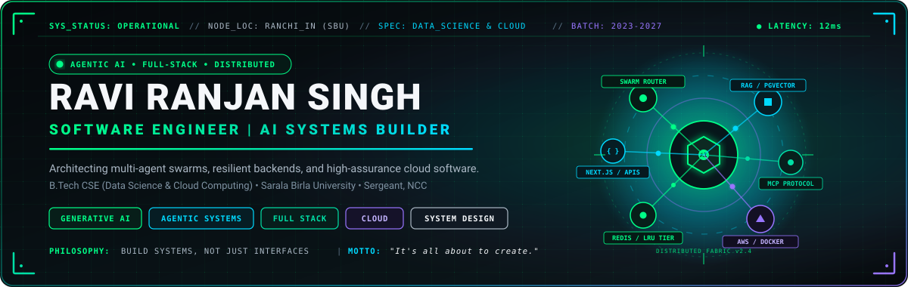
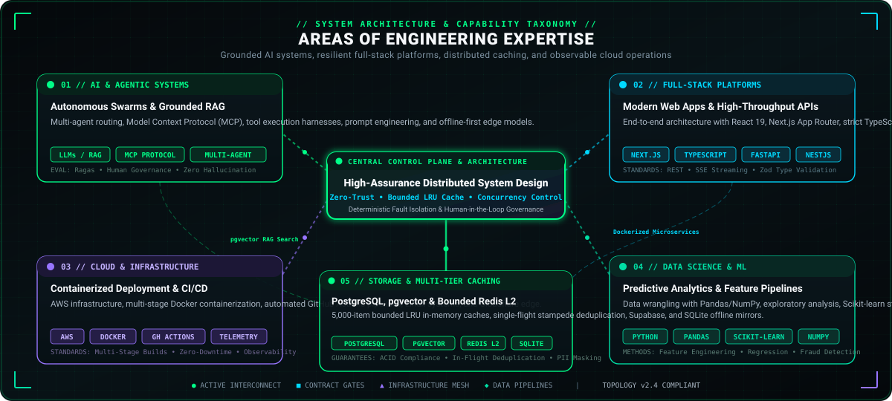

<div align="center">

<!-- HERO BANNER -->


<br /><br />

<!-- STATUS & TELEMETRY BADGES -->
<a href="https://www.linkedin.com/in/ravi-ranjan-singh-0808ii/">
  
</a>
<a href="https://github.com/Hellthefox808">
  
</a>


<br /><br />

<h3>Software Engineer · AI Systems Builder · Full-Stack &amp; Cloud</h3>

<p>
  <b><i>"It's all about to create."</i></b><br />
  Architecting high-assurance agentic systems, resilient full-stack backends, and scalable cloud platforms.
</p>


</div>

<br />

## 01 // About Me

I am **Ravi Ranjan Singh**, a Software Engineer and Computer Science undergraduate specializing in **Data Science &amp; Cloud Computing** at **Sarala Birla University, Ranchi** (Batch 2023–2027).

My engineering work focuses on the intersection of **full-stack software architecture, applied generative AI, and cloud distributed systems**. I design and build end-to-end software: from ergonomic, type-safe frontend interfaces and high-throughput REST/SSE backends to autonomous multi-agent swarms with deterministic guardrails, multi-tier LRU caching, and automated CI/CD deployments.

Rather than building superficial demos, I am dedicated to engineering software that operates reliably in production: systems with bounded resource usage, zero-trust security postures, cryptographic integrity, and thorough observability.

```text
┌─────────────────────────────────────────────────────────────────────────────────────────────────┐
│ CANDIDATE TELEMETRY                                                                             │
├──────────────────────┬──────────────────────────────────────────────────────────────────────────┤
│ Full Name            │ Ravi Ranjan Singh                                                        │
│ Professional Focus   │ Software Engineer · AI Systems Builder · Cloud & Distributed Systems     │
│ Degree & Major       │ B.Tech in Computer Science and Engineering (Data Science & Cloud)        │
│ Institution          │ Sarala Birla University, Ranchi (2023–2027)                              │
│ Leadership & Honours │ Sergeant (SGT), 19 Jharkhand Bn NCC · Best Cadet (2019) · Taekwondo 1st D│
│ Public Repositories  │ 39+ Repositories spanning AI Agents, Full-Stack SaaS & ML Pipelines      │
│ Operating Mindset    │ Build systems, not just interfaces. Validate decisions through evidence. │
└──────────────────────┴──────────────────────────────────────────────────────────────────────────┘
```

<br />

## 02 // Engineering Identity

My engineering practice is grounded in four foundational disciplines:

<table>
  <tr>
    <td width="50%" valign="top">
      <h4>⚡ 1. Software Engineering &amp; Architecture</h4>
      <p>
        Building decoupled, maintainable software architectures using clean domain-driven boundaries, SOLID principles, and microservices. Dedicated to deterministic execution, strict type contracts, idempotent operations, and performance tuning.
      </p>
      <sub><b>Core focus:</b> Microservices · API Design · Concurrency Control · Performance Engineering</sub>
    </td>
    <td width="50%" valign="top">
      <h4>🧠 2. AI &amp; Agentic Systems</h4>
      <p>
        Designing production-grade AI applications beyond standard prompt chains: autonomous multi-agent orchestration swarms, contextual Retrieval-Augmented Generation (RAG) with vector databases, Model Context Protocol (MCP) tool execution, and human-in-the-loop audit ledgers.
      </p>
      <sub><b>Core focus:</b> Autonomous Agents · RAG · MCP Protocol · Zero-Hallucination Guardrails</sub>
    </td>
  </tr>
  <tr>
    <td width="50%" valign="top">
      <h4>🌐 3. Full-Stack Platform Engineering</h4>
      <p>
        Crafting seamless, accessible, and reactive user experiences paired with resilient backend services. Extensive experience across the React/Next.js ecosystem, modern Node.js/NestJS runtimes, and high-performance Python FastAPI microservices.
      </p>
      <sub><b>Core focus:</b> React 19 · Next.js App Router · TypeScript · FastAPI · Tailwind CSS</sub>
    </td>
    <td width="50%" valign="top">
      <h4>☁️ 4. Cloud, Distributed Systems &amp; Data</h4>
      <p>
        Architecting scalable cloud infrastructure using AWS, multi-stage Docker containerization, automated CI/CD pipelines, and multi-tier caching (L1 in-memory bounded LRU + L2 Redis). Leveraging data pipelines with Pandas and Scikit-learn for actionable intelligence.
      </p>
      <sub><b>Core focus:</b> AWS · Docker · CI/CD · PostgreSQL (pgvector) · Redis · Data Science</sub>
    </td>
  </tr>
</table>

<br />

## 03 // Areas of Expertise

<div align="center">
  
</div>

<br />

| Domain | Architectural Focus &amp; Practical Capabilities | Standards &amp; Guarantees |
|---|---|---|
| **AI &amp; Agentic Systems** | Autonomous multi-agent swarms, Model Context Protocol (MCP) clients/servers, Retrieval-Augmented Generation (RAG), vector similarity search, tool-calling pipelines, prompt evaluation harnesses, and offline-first edge models. | Zero-hallucination guardrails, human-in-the-loop oversight, deterministic tool contracts. |
| **Full-Stack Engineering** | Server-Side Rendering (SSR), React Server Components, Next.js App Router, strict TypeScript schema validation (Zod), FastAPI microservices, NestJS, and REST/SSE streaming APIs. | Strict type safety across network boundaries, reactive UI states, sub-50ms API responses. |
| **Cloud &amp; DevOps** | AWS infrastructure, multi-stage Docker containerization, automated GitHub Actions CI/CD workflows, Linux system administration, Cloudflare edge networks, and application telemetry. | Automated regression test gates, reproducible builds, continuous zero-downtime delivery. |
| **Storage &amp; Multi-Tier Caching** | PostgreSQL relational modeling, `pgvector` semantic vector search, Supabase, Redis L2 caching clusters, bounded L1 in-memory LRU caches (`MAX_MEMORY_ITEMS = 5000`), and SQLite offline persistence. | Single-flight cache stampede deduplication, ACID compliance, PII data masking at rest. |
| **Security &amp; Distributed Systems** | Salted scrypt key derivation ($N=16384, r=8, p=1$), UIDAI Verhoeff algorithm ($D_5$) Aadhaar checksum verification, Role-Based Access Control (RBAC), and queue concurrency draining. | Defense-in-depth, constant-time hash comparison, rate-limiting brute-force lockouts. |

<div align="center">
  
</div>

<br />

## 04 // Technical Stack

### Production &amp; Practical Experience

```text
LANGUAGES     ::  Python  •  TypeScript  •  JavaScript  •  SQL (PostgreSQL)  •  C++  •  Java  •  HTML5  •  CSS3
FRONTEND      ::  React.js  •  Next.js (App Router)  •  Tailwind CSS  •  Framer Motion  •  Vite
BACKEND       ::  Node.js  •  FastAPI (Python)  •  Express.js  •  NestJS  •  REST APIs  •  Server-Sent Events (SSE)
AI & AGENTS   ::  Generative AI  •  Autonomous Agents  •  RAG Pipelines  •  Model Context Protocol (MCP)  •  Scikit-Learn  •  Pandas  •  NumPy
DATABASES     ::  PostgreSQL (pgvector)  •  Redis (L1/L2 Multi-Tier)  •  Supabase  •  MongoDB  •  SQLite
CLOUD/DEVOPS  ::  AWS  •  Docker  •  GitHub Actions (CI/CD)  •  Linux SysAdmin  •  Cloudflare  •  Nginx
TOOLING       ::  Git  •  Vitest  •  Jest  •  VS Code  •  Postman  •  pnpm  •  Bun  •  Prisma ORM
```

<div align="center">
  <h4>Core Technologies</h4>
  
</div>

<br />

### Active Research &amp; Current Exploration

Technologies and topics actively being researched, prototyped, and benchmarked:

- **Kubernetes &amp; Container Orchestration:** Production multi-pod scaling, service meshes, and Helm deployments.
- **Systems Programming in Rust:** Memory safety without garbage collection, zero-cost abstractions, and WebAssembly compilation.
- **Graph Databases &amp; Knowledge Graphs:** Neo4j and hybrid Graph-RAG architectures for entity relationship reasoning.
- **Formal Verification &amp; LLMOps:** Automated evaluation frameworks (Ragas, TruLens), synthetic test generation, and red-teaming containment.

<div align="center">
  
</div>

<br />

## 05 // Featured Projects

An evidence-based selection of real projects built, architected, and maintained across my repositories:

<table>
  <!-- PROJECT 1: SHIVI / PRAVRAHA -->
  <tr>
    <td width="50%" valign="top">
      <h3>
        <a href="https://github.com/Hellthefox808/ShiVi-D">
          🔮 PravRaha / ShiVi · AI-Native RevOps &amp; Control Plane
        </a>
      </h3>
      <p>
        An enterprise-grade autonomous B2B revenue operations platform and agent control plane architected for high-assurance autonomous execution.
      </p>
      <ul>
        <li><b>Multi-Agent Swarm:</b> Coordinates 38 specialized micro-agents across 100 autonomous domain engines with dynamic routing and human-in-the-loop governance.</li>
        <li><b>Contextual Retrieval:</b> Vector search via PostgreSQL <code>pgvector</code> paired with Model Context Protocol (MCP) sandboxed tool integration.</li>
        <li><b>Verified Reliability:</b> Comprehensive test harness with <b>471 passing Vitest assertions</b> across 167 suites, zero-trust security perimeter, and evidence ledger.</li>
      </ul>
      <p>
        <sub><b>Stack:</b> Python · FastAPI · Next.js · TypeScript · PostgreSQL (pgvector) · Redis · MCP · Vitest</sub>
      </p>
      <p>
        <a href="https://github.com/Hellthefox808/ShiVi-D">
          
        </a>
        
      </p>
    </td>
    <!-- PROJECT 2: NCC CRM -->
    <td width="50%" valign="top">
      <h3>
        <a href="https://github.com/Hellthefox808/NCC-CRM-V1.0">
          🛡️ 19 Jharkhand Bn NCC Command Centre (NCC CRM)
        </a>
      </h3>
      <p>
        A mission-critical operational command and cadet lifecycle platform built for the 19 Jharkhand Battalion NCC with enterprise defense-in-depth security.
      </p>
      <ul>
        <li><b>High-Assurance Architecture:</b> Nginx load balancer failover, Supabase/PostgreSQL database, and multi-channel notification dispatchers.</li>
        <li><b>Distributed Caching:</b> Two-tier bounded LRU cache (<code>MAX_MEMORY_ITEMS = 5000</code>) with single-flight promise deduplication to eliminate thundering herd stampedes.</li>
        <li><b>Government-Grade Verification:</b> Salted scrypt key derivation ($N=16384, r=8, p=1$), UIDAI Verhoeff algorithm ($D_5$) Aadhaar checksum verification, and automated PII masking.</li>
      </ul>
      <p>
        <sub><b>Stack:</b> TypeScript · Node.js · Express · Vite · React · Supabase / PostgreSQL · Redis · Docker · Nginx</sub>
      </p>
      <p>
        <a href="https://github.com/Hellthefox808/NCC-CRM-V1.0">
          
        </a>
        
      </p>
    </td>
  </tr>

  <!-- PROJECT 3: BHASHASAETU AI -->
  <tr>
    <td width="50%" valign="top">
      <h3>
        <a href="https://github.com/Hellthefox808/ShiVi-AI-Offline-First-Multilingual-Education-Platform">
          🌐 BhashaSetu AI · Offline-First Multilingual Platform
        </a>
      </h3>
      <p>
        An AI-powered Mother Tongue-Based Multilingual Education (MTB-MLE) platform bridging regional educators with tribal language communities (Santhali, Ho, and Mundari).
      </p>
      <ul>
        <li><b>Offline-First Resilience:</b> Edge-first retrieval architecture allowing classroom AI assistance without continuous internet connectivity.</li>
        <li><b>Bi-Directional Sync:</b> Local SQLite database state deterministically synchronizes with cloud PostgreSQL when connectivity resumes.</li>
        <li><b>Pedagogical Adaptation:</b> Voice and text translation pipelines optimized for low-resource tribal language preservation.</li>
      </ul>
      <p>
        <sub><b>Stack:</b> Python · Offline RAG · SQLite · PostgreSQL · TypeScript · Speech DSP · Web Audio</sub>
      </p>
      <p>
        <a href="https://github.com/Hellthefox808/ShiVi-AI-Offline-First-Multilingual-Education-Platform">
          
        </a>
        
      </p>
    </td>
    <!-- PROJECT 4: AGRI-TECH -->
    <td width="50%" valign="top">
      <h3>
        <a href="https://github.com/Hellthefox808/agri-tech-2..0">
          🌱 AIoT Agri-Health Guardian (agri-tech-2..0)
        </a>
      </h3>
      <p>
        An intelligent precision agriculture and soil telemetry monitoring system integrating hardware sensors with machine learning anomaly detection.
      </p>
      <ul>
        <li><b>Sensor Ingestion:</b> Captures real-time soil moisture, ambient temperature, humidity, and environmental metrics.</li>
        <li><b>Edge Heuristics:</b> Machine learning inference models detect crop stress, irrigation deficits, and pathogen risks early.</li>
        <li><b>Actionable Telemetry:</b> Low-latency dashboard displaying automated advisory recommendations for farmers.</li>
      </ul>
      <p>
        <sub><b>Stack:</b> TypeScript · IoT Sensor Telemetry · Python · REST APIs · Scikit-Learn · Reactive Dashboard</sub>
      </p>
      <p>
        <a href="https://github.com/Hellthefox808/agri-tech-2..0">
          
        </a>
        
      </p>
    </td>
  </tr>

  <!-- PROJECT 5: TRAVEL NEST & EXPENSE TRACKER -->
  <tr>
    <td width="50%" valign="top">
      <h3>
        <a href="https://github.com/Hellthefox808/Travel-v1.1.2-Buget">
          ✈️ Travel Nest (Travel-v1.1.2-Buget)
        </a>
      </h3>
      <p>
        A digital travel platform and intelligent budget management engine designed for multi-destination planning and cost forecasting.
      </p>
      <ul>
        <li><b>Budget Forecasting:</b> Heuristic expense tracking algorithm preventing budget overruns during complex itineraries.</li>
        <li><b>Modular Architecture:</b> Decoupled API routes, responsive client UI, and structured currency conversion models.</li>
      </ul>
      <p>
        <sub><b>Stack:</b> JavaScript · Node.js · Express · REST APIs · Responsive UX</sub>
      </p>
      <p>
        <a href="https://github.com/Hellthefox808/Travel-v1.1.2-Buget">
          
        </a>
      </p>
    </td>
    <td width="50%" valign="top">
      <h3>
        <a href="https://github.com/Hellthefox808/Expense-tracker">
          📊 Glassmorphic Financial Engine (Expense-tracker)
        </a>
      </h3>
      <p>
        A premium financial intelligence and budget telemetry dashboard with real-time analytics and category breakdown.
      </p>
      <ul>
        <li><b>Interactive Telemetry:</b> Chart.js visual analytics rendering income-to-expense ratios and trend forecasts.</li>
        <li><b>Persistent Storage:</b> Mongoose data schemas with transactional integrity and session-based authentication.</li>
      </ul>
      <p>
        <sub><b>Stack:</b> Node.js · Express.js · MongoDB / Mongoose · Chart.js · EJS</sub>
      </p>
      <p>
        <a href="https://github.com/Hellthefox808/Expense-tracker">
          
        </a>
      </p>
    </td>
  </tr>
</table>

<br />

## 06 // Engineering Philosophy

```text
┌─────────────────────────────────────────────────────────────────────────────────────────────────┐
│ SEVEN OPERATING PRINCIPLES OF ARCHITECTURE & DEVELOPMENT                                        │
├─────────────────────────────────────────────────────────────────────────────────────────────────┤
│ 1. BUILD SYSTEMS, NOT JUST INTERFACES                                                           │
│    Real software quality is determined by the resilience of data layers, state machines,        │
│    error boundaries, latency characteristics, and failure modes—not cosmetic aesthetics alone. │
│                                                                                                 │
│ 2. ARCHITECTURE BEFORE UNNECESSARY COMPLEXITY                                                   │
│    Resist premature abstraction and cargo-cult tooling. Design clean, decoupled domain          │
│    contracts with minimal external dependencies. Simplicity is the ultimate sophistication.     │
│                                                                                                 │
│ 3. WRITE MAINTAINABLE, OBSERVABLE, AND OPTIMIZED CODE                                           │
│    Prioritize strict type safety, explicit error returns over silent failures, descriptive      │
│    naming, structured logging, and measurable time/space complexity bounds.                     │
│                                                                                                 │
│ 4. DESIGN FOR SECURITY, RELIABILITY, AND OBSERVABILITY BY DEFAULT                               │
│    Enforce defense-in-depth: constant-time cryptographic verification, bounded in-memory       │
│    caches, rate-limiting gates, and audit trails from Day 1 of system design.                   │
│                                                                                                 │
│ 5. VALIDATE ARCHITECTURAL DECISIONS THROUGH EVIDENCE                                            │
│    Hypotheses require verification through comprehensive unit suites, integration tests,        │
│    and benchmark telemetry. If a feature isn't tested, it is broken by definition.              │
│                                                                                                 │
│ 6. TREAT AI AS AN ENGINEERING CAPABILITY, NOT A GIMMICK                                         │
│    Ground generative models with deterministic schemas, Model Context Protocol (MCP) tools,     │
│    bounded vector retrieval (RAG), and human-in-the-loop oversight to prevent hallucinations.  │
│                                                                                                 │
│ 7. CONTINUOUS LEARNING, RIGOROUS EXPERIMENTATION, AND DISCIPLINED SHIPMENT                      │
│    Stay relentlessly curious across compiler designs, distributed primitives, and AI frontiers. │
│    Execute with military discipline, take ownership, and consistently deliver.                  │
└─────────────────────────────────────────────────────────────────────────────────────────────────┘
```

<div align="center">
  
</div>

<br />

## 07 // GitHub Analytics &amp; Telemetry

<div align="center">
  <!-- GitHub Stats Card -->
  <a href="https://github.com/Hellthefox808">
    
  </a>
  <!-- Most Used Languages Card -->
  <a href="https://github.com/Hellthefox808">
    
  </a>

  <br /><br />

  <!-- GitHub Streak Card -->
  <a href="https://github.com/Hellthefox808">
    
  </a>
</div>

<br />

## 08 // Leadership &amp; Operational Discipline

Beyond code, I cultivate structured leadership, high accountability, and the ability to execute under pressure through military and martial arts training.

### National Cadet Corps (NCC) — 19 Jharkhand Battalion

- **Cadet Rank:** Sergeant (SGT) with Senior Cadet / Under Officer leadership experience.
- **Unit Command &amp; Coordination:** Commanded cadet contingents during ceremonial parades, field drills, and battalion training camps; mentored junior cadets in discipline, weapon handling, and operational protocols.
- **Event Administration:** Coordinated large-scale logistics, communication dispatches, and security protocols for institutional ceremonies and community outreach drives.
- **Distinctions:** Honoured with **Best Cadet (2019)** and awarded the **NCC Cadet Scholarship** for outstanding leadership, parade drill excellence, and academic merit.

### Martial Arts &amp; Athletic Conditioning

- **Black Belt Holder (1st Dan) in Taekwondo &amp; Competitive Judo Experience.**
- **National-Level Competitor:** Competed in state and national martial arts tournaments, instilling mental composure, rapid reflex response, and physical resilience.
- **The Engineering Parallel:** The discipline of martial arts—demanding relentless repetition, precision under high stakes, and rapid crisis adaptation—directly translates into how I approach software outages, distributed system debugging, and mission-critical production deadlines.

<div align="center">
  
</div>

<br />

## 09 // Certifications &amp; Credentials

- **Cisco Networking Academy (7 Professional Credentials):**
  - CCNA: Introduction to Networks (ITN) — Enterprise Network Topologies, IPv4/IPv6, Ethernet &amp; Switching.
  - CCNA: Switching, Routing, and Wireless Essentials (SRWE) — VLANs, Inter-VLAN Routing, STP, EtherChannel.
  - CCNA: Enterprise Networking, Security, and Automation (ENSA) — OSPF, WAN Concepts, QoS, Network Programmability.
  - Cisco CCNA Cybersecurity &amp; Threat Defense Fundamentals.
  - Cisco Python Essentials (PCAP Certified Fundamentals).
  - Cisco Data Science &amp; Machine Learning Fundamentals.
  - Cisco Network Operating Systems &amp; Linux Administration.
- **Honours &amp; Awards:**
  - Best Cadet Award (19 Jharkhand Battalion NCC, 2019).
  - National Cadet Corps Meritorious Scholarship.
  - National-Level Martial Arts Tournament Competitor (Black Belt 1st Dan).

<br />

## 10 // Collaboration &amp; Opportunities

I am actively seeking:

- **Software Engineering Roles &amp; Internships:** Full-stack development, backend platform engineering, and cloud infrastructure.
- **AI Systems &amp; Agentic Engineering:** Applied LLM systems, RAG pipeline engineering, autonomous agent design, and MCP tool architecture.
- **High-Impact Open Source Collaborations:** System-level tooling, distributed databases, developer tooling, and mission-critical platforms.

If you are building products that solve complex engineering challenges, let’s connect:

<div align="center">

<a href="https://www.linkedin.com/in/ravi-ranjan-singh-0808ii/">
  
</a>
<a href="https://github.com/Hellthefox808">
  
</a>

</div>

<br />

---

<div align="center">

<p>
  <b>"Think deeply. Architect deliberately. Ship with evidence."</b><br />
  <sub>Ravi Ranjan Singh // Software Engineer // Node ID: RR-0808 // Sarala Birla University</sub>
</p>

<b><i>It's all about to create.</i></b>

</div>
