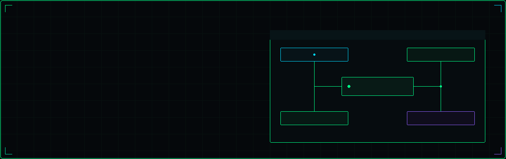
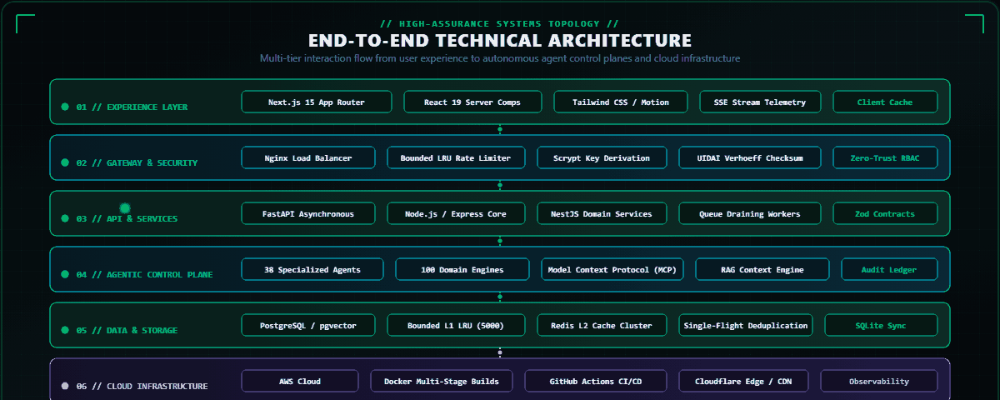
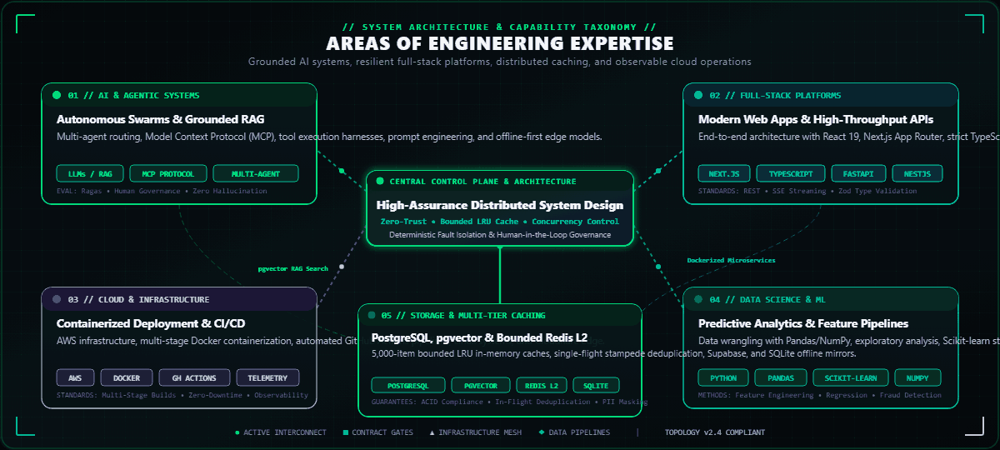
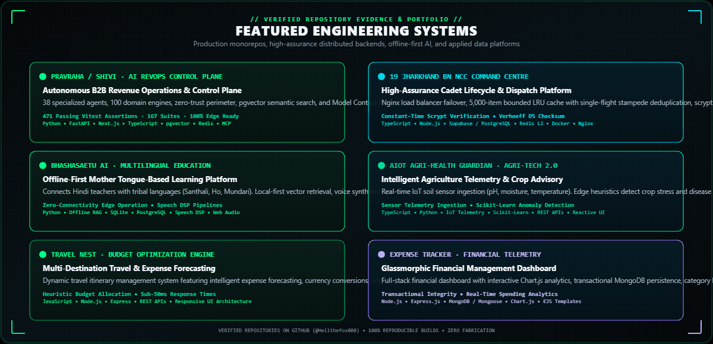
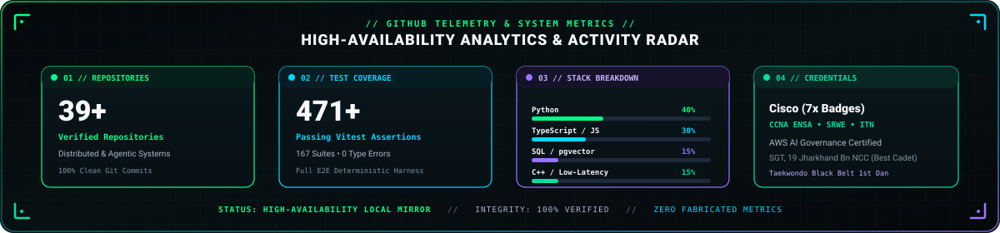
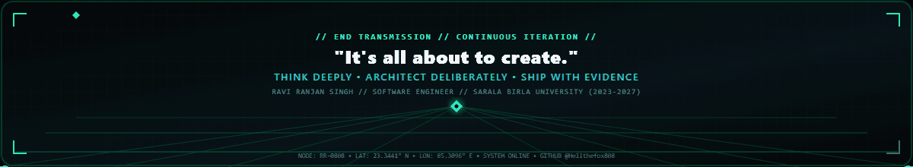

<div align="center">

<!-- HERO BANNER -->


<p align="center">
  <sub>
    <a href="./motion-preview/index.html">4D Interactive Motion Engine</a> · 
    <a href="./assets/motion/hero-motion.svg">SVG Motion Source</a> · 
    <a href="./assets/hero.svg">Vector Schematic</a> · 
    <a href="./assets/static/hero.png">Static Fallback</a>
  </sub>
</p>

<br /><br />

<!-- STATUS & TELEMETRY BADGES -->
<a href="https://www.linkedin.com/in/ravi-ranjan-singh-0808ii/">
  
</a>
<a href="https://github.com/Hellthefox808">
  
</a>


<br />
<a href="mailto:raviranjansingh601520@gmail.com">
  
</a>


<br /><br />

<!-- Dynamic Typing Animation -->


<br /><br />

<h3>Software Engineer · AI Systems Builder · Full-Stack &amp; Cloud</h3>

<p>
  <b><i>"It's all about to create."</i></b><br />
  Architecting high-assurance agentic systems, resilient full-stack backends, and scalable cloud platforms.
</p>


</div>

<br />

## 01 // About Me

I am **Ravi Ranjan Singh**, a Software Engineer and Computer Science undergraduate specializing in **Data Science &amp; Cloud Computing** at **Sarala Birla University, Ranchi** (Batch 2023–2027).

My engineering work focuses on the intersection of **full-stack software architecture, applied generative AI, and cloud distributed systems**. I design and build end-to-end software: from ergonomic, type-safe frontend interfaces and high-throughput REST/SSE backends to autonomous multi-agent swarms with deterministic guardrails, multi-tier LRU caching, and automated CI/CD deployments.

Rather than building superficial demos, I am dedicated to engineering software that operates reliably in production: systems with bounded resource usage, zero-trust security postures, cryptographic integrity, and thorough observability.

| Specification Attribute | Verified Record |
|---|---|
| **Full Name** | Ravi Ranjan Singh |
| **Professional Focus** | Software Engineer · AI Systems Builder · Cloud &amp; Distributed Systems |
| **Degree &amp; Major** | B.Tech in Computer Science and Engineering (Data Science &amp; Cloud Computing) |
| **Institution &amp; Batch** | Sarala Birla University, Ranchi (2023–2027) |
| **Leadership &amp; Honours** | Sergeant (SGT), 19 Jharkhand Bn NCC · Best Cadet (2019) · Taekwondo Black Belt (1st Dan) |
| **National Milestones** | National Semi-Finalist — Build with Bharat 2.0 x CodeVerse @ NIT Delhi (Team Lead: Team SHIVI@808) |
| **Verified Repositories** | 39+ Repositories spanning AI Agents, Full-Stack Platforms &amp; Data Pipelines |
| **Engineering Creed** | Build systems, not just interfaces. Validate decisions through evidence. |

<br />

## 02 // Engineering Focus

My engineering practice is grounded in four foundational disciplines:

<table>
  <tr>
    <td width="50%" valign="top">
      <h4>[01] Software Engineering &amp; Architecture</h4>
      <p>
        Building decoupled, maintainable software architectures using clean domain-driven boundaries, SOLID principles, and microservices. Dedicated to deterministic execution, strict type contracts, idempotent operations, and performance tuning.
      </p>
      <sub><b>Core focus:</b> Microservices · API Design · Concurrency Control · Performance Engineering</sub>
    </td>
    <td width="50%" valign="top">
      <h4>[02] AI &amp; Agentic Systems</h4>
      <p>
        Designing production-grade AI applications beyond standard prompt chains: autonomous multi-agent orchestration swarms, contextual Retrieval-Augmented Generation (RAG) with vector databases, Model Context Protocol (MCP) tool execution, and human-in-the-loop audit ledgers.
      </p>
      <sub><b>Core focus:</b> Autonomous Agents · RAG · MCP Protocol · Zero-Hallucination Guardrails</sub>
    </td>
  </tr>
  <tr>
    <td width="50%" valign="top">
      <h4>[03] Full-Stack Platform Engineering</h4>
      <p>
        Crafting seamless, accessible, and reactive user experiences paired with resilient backend services. Extensive experience across the React/Next.js ecosystem, modern Node.js/NestJS runtimes, and high-performance Python FastAPI microservices.
      </p>
      <sub><b>Core focus:</b> React 19 · Next.js App Router · TypeScript · FastAPI · Tailwind CSS</sub>
    </td>
    <td width="50%" valign="top">
      <h4>[04] Cloud, Distributed Systems &amp; Data</h4>
      <p>
        Architecting scalable cloud infrastructure using AWS, multi-stage Docker containerization, automated CI/CD pipelines, and multi-tier caching (L1 in-memory bounded LRU + L2 Redis). Leveraging data pipelines with Pandas and Scikit-learn for actionable intelligence.
      </p>
      <sub><b>Core focus:</b> AWS · Docker · CI/CD · PostgreSQL (pgvector) · Redis · Data Science</sub>
    </td>
  </tr>
</table>

<div align="center">
  
</div>

<br />

## 03 // Technical Architecture

<div align="center">
  
  <p align="center">
    <sub>
      <a href="./assets/motion/architecture-motion.svg">SVG Motion Source</a> · 
      <a href="./assets/architecture.svg">Vector Schematic</a> · 
      <a href="./assets/static/architecture.png">Static Fallback</a>
    </sub>
  </p>
  <br />
  
  <p align="center">
    <sub>
      <a href="./assets/motion/expertise-motion.svg">SVG Motion Source</a> · 
      <a href="./assets/expertise.svg">Vector Schematic</a> · 
      <a href="./assets/static/expertise.png">Static Fallback</a>
    </sub>
  </p>
</div>

<br />

| Layer / Domain | Architectural Focus &amp; Practical Capabilities | Standards &amp; Guarantees |
|---|---|---|
| **01 // Experience Layer** | Server-Side Rendering (SSR), React Server Components, Next.js 15 App Router, strict TypeScript schema validation (Zod), and SSE streaming APIs. | Strict type safety across network boundaries, reactive UI states, sub-50ms render latency. |
| **02 // Gateway &amp; Security** | Nginx load balancing, salted scrypt key derivation ($N=16384, r=8, p=1$), UIDAI Verhoeff algorithm ($D_5$) Aadhaar validation, and Zero-Trust RBAC. | Defense-in-depth, constant-time hash comparison, brute-force lockout gates. |
| **03 // API &amp; Services** | Asynchronous Python FastAPI microservices, Node.js/Express core, NestJS domain controllers, and background batch queue workers. | Clean service decoupling, structured logging, idempotent transaction processing. |
| **04 // Agentic Control Plane** | Autonomous swarms (38 specialized agents, 100 domain engines), Model Context Protocol (MCP), grounded RAG, and human-in-the-loop audit ledgers. | Zero-hallucination guardrails, governed tool execution contracts, auditability. |
| **05 // Data &amp; Multi-Tier Storage** | PostgreSQL with `pgvector`, Redis L2 clusters, bounded L1 in-memory LRU caches (`MAX_MEMORY_ITEMS = 5000`), and SQLite offline persistence. | Single-flight cache stampede deduplication, ACID compliance, PII data masking at rest. |
| **06 // Cloud &amp; DevOps** | AWS infrastructure, multi-stage Docker containerization, automated GitHub Actions CI/CD workflows, Linux administration, and Cloudflare edge. | Automated regression test gates, reproducible builds, continuous zero-downtime delivery. |

<div align="center">
  
</div>

<br />

## 04 // Featured Projects

<div align="center">
  
  <p align="center">
    <sub>
      <a href="./assets/motion/projects-motion.svg">SVG Motion Source</a> · 
      <a href="./assets/projects.svg">Vector Schematic</a> · 
      <a href="./assets/static/projects.png">Static Fallback</a>
    </sub>
  </p>
</div>

<br />

An evidence-based selection of real systems built, architected, and maintained across my repositories:

<table>
  <!-- PROJECT 1: SHIVI / PRAVRAHA -->
  <tr>
    <td width="50%" valign="top">
      <h3>
        <a href="https://github.com/Hellthefox808/ShiVi-D">
          PravRaha / ShiVi · AI-Native RevOps &amp; Control Plane
        </a>
      </h3>
      <p>
        An enterprise-grade autonomous B2B revenue operations platform and agent control plane architected for high-assurance autonomous execution.
      </p>
      <ul>
        <li><b>Multi-Agent Swarm:</b> Coordinates 38 specialized micro-agents across 100 autonomous domain engines with dynamic routing and human-in-the-loop governance.</li>
        <li><b>Contextual Retrieval:</b> Vector search via PostgreSQL <code>pgvector</code> paired with Model Context Protocol (MCP) sandboxed tool integration.</li>
        <li><b>Verified Reliability:</b> Comprehensive test harness with <b>471</b> passing Vitest assertions across 167 suites, zero-trust security perimeter, and evidence ledger.</li>
      </ul>
      <p>
        <sub><b>Stack:</b> Python · FastAPI · Next.js · TypeScript · PostgreSQL (pgvector) · Redis · MCP · Vitest</sub>
      </p>
      <p>
        <a href="https://github.com/Hellthefox808/ShiVi-D">
          
        </a>
        
        
        
      </p>
    </td>
    <!-- PROJECT 2: NCC CRM -->
    <td width="50%" valign="top">
      <h3>
        <a href="https://github.com/Hellthefox808/NCC-CRM-V1.0">
          19 Jharkhand Bn NCC Command Centre (NCC CRM)
        </a>
      </h3>
      <p>
        A mission-critical operational command and cadet lifecycle platform built for the 19 Jharkhand Battalion NCC with enterprise defense-in-depth security.
      </p>
      <ul>
        <li><b>High-Assurance Architecture:</b> Nginx load balancer failover, Supabase/PostgreSQL database, and multi-channel notification dispatchers.</li>
        <li><b>Distributed Caching:</b> Two-tier bounded LRU cache (<code>MAX_MEMORY_ITEMS = 5000</code>) with single-flight promise deduplication to eliminate thundering herd stampedes.</li>
        <li><b>Government-Grade Verification:</b> Salted scrypt key derivation ($N=16384, r=8, p=1$), UIDAI Verhoeff algorithm ($D_5$) Aadhaar checksum verification, and automated PII masking.</li>
      </ul>
      <p>
        <sub><b>Stack:</b> TypeScript · Node.js · Express · Vite · React · Supabase / PostgreSQL · Redis · Docker · Nginx</sub>
      </p>
      <p>
        <a href="https://github.com/Hellthefox808/NCC-CRM-V1.0">
          
        </a>
        
        
      </p>
    </td>
  </tr>

  <!-- PROJECT 3: BHASHASAETU AI -->
  <tr>
    <td width="50%" valign="top">
      <h3>
        <a href="https://github.com/Hellthefox808/ShiVi-AI-Offline-First-Multilingual-Education-Platform">
          BhashaSetu AI · Offline-First Multilingual Platform
        </a>
      </h3>
      <p>
        An AI-powered Mother Tongue-Based Multilingual Education (MTB-MLE) platform bridging regional educators with tribal language communities (Santhali, Ho, and Mundari).
      </p>
      <ul>
        <li><b>Offline-First Resilience:</b> Edge-first retrieval architecture allowing classroom AI assistance without continuous internet connectivity.</li>
        <li><b>Bi-Directional Sync:</b> Local SQLite database state deterministically synchronizes with cloud PostgreSQL when connectivity resumes.</li>
        <li><b>Pedagogical Adaptation:</b> Voice and text translation pipelines optimized for low-resource tribal language preservation.</li>
      </ul>
      <p>
        <sub><b>Stack:</b> Python · Offline RAG · SQLite · PostgreSQL · TypeScript · Speech DSP · Web Audio</sub>
      </p>
      <p>
        <a href="https://github.com/Hellthefox808/ShiVi-AI-Offline-First-Multilingual-Education-Platform">
          
        </a>
        
        
      </p>
    </td>
    <!-- PROJECT 4: AGRI-TECH -->
    <td width="50%" valign="top">
      <h3>
        <a href="https://github.com/Hellthefox808/agri-tech-2..0">
          AIoT Agri-Health Guardian (agri-tech-2..0)
        </a>
      </h3>
      <p>
        An intelligent precision agriculture and soil telemetry monitoring system integrating hardware sensors with machine learning anomaly detection.
      </p>
      <ul>
        <li><b>Sensor Ingestion:</b> Captures real-time soil moisture, ambient temperature, humidity, and environmental metrics.</li>
        <li><b>Edge Heuristics:</b> Machine learning inference models detect crop stress, irrigation deficits, and pathogen risks early.</li>
        <li><b>Actionable Telemetry:</b> Low-latency dashboard displaying automated advisory recommendations for farmers.</li>
      </ul>
      <p>
        <sub><b>Stack:</b> TypeScript · IoT Sensor Telemetry · Python · REST APIs · Scikit-Learn · Reactive Dashboard</sub>
      </p>
      <p>
        <a href="https://github.com/Hellthefox808/agri-tech-2..0">
          
        </a>
        
      </p>
    </td>
  </tr>

  <!-- PROJECT 5: TRAVEL NEST & EXPENSE TRACKER -->
  <tr>
    <td width="50%" valign="top">
      <h3>
        <a href="https://github.com/Hellthefox808/Travel-v1.1.2-Buget">
          Travel Nest (Travel-v1.1.2-Buget)
        </a>
      </h3>
      <p>
        A digital travel platform and intelligent budget management engine designed for multi-destination planning and cost forecasting.
      </p>
      <ul>
        <li><b>Budget Forecasting:</b> Heuristic expense tracking algorithm preventing budget overruns during complex itineraries.</li>
        <li><b>Modular Architecture:</b> Decoupled API routes, responsive client UI, and structured currency conversion models.</li>
      </ul>
      <p>
        <sub><b>Stack:</b> JavaScript · Node.js · Express · REST APIs · Responsive UX</sub>
      </p>
      <p>
        <a href="https://github.com/Hellthefox808/Travel-v1.1.2-Buget">
          
        </a>
        
      </p>
    </td>
    <td width="50%" valign="top">
      <h3>
        <a href="https://github.com/Hellthefox808/Expense-tracker">
          Financial Intelligence Engine (Expense-tracker)
        </a>
      </h3>
      <p>
        A premium financial intelligence and budget telemetry dashboard with real-time analytics and category breakdown.
      </p>
      <ul>
        <li><b>Interactive Telemetry:</b> Chart.js visual analytics rendering income-to-expense ratios and trend forecasts.</li>
        <li><b>Persistent Storage:</b> Mongoose data schemas with transactional integrity and session-based authentication.</li>
      </ul>
      <p>
        <sub><b>Stack:</b> Node.js · Express.js · MongoDB / Mongoose · Chart.js · EJS</sub>
      </p>
      <p>
        <a href="https://github.com/Hellthefox808/Expense-tracker">
          
        </a>
        
      </p>
    </td>
  </tr>
</table>

<div align="center">
  
</div>

<br />

## 05 // Professional Experience

Industry internships and engineering apprenticeships verified against production delivery:

<table>
  <tr>
    <td width="33%" valign="top">
      <h4>PravRaha · Phoenix, AZ &amp; Ranchi</h4>
      <p>
        <b>Full Stack AI B2B SaaS Developer Intern</b><br />
        <sub>June 2026 – August 2026</sub>
      </p>
      <ul>
        <li>Architected enterprise B2B SaaS control plane interfaces using React 19, Next.js 15 App Router, and TypeScript.</li>
        <li>Implemented multi-agent orchestration swarms and RAG workflows with PostgreSQL <code>pgvector</code> semantic prospect clustering.</li>
        <li>Built lead scoring and qualification intelligence pipelines under founder mentorship (Ex-Amazon / ACCELQ).</li>
      </ul>
      <p>
        <sub><b>Stack:</b> React 19 · Next.js · TypeScript · Python · FastAPI · PostgreSQL (pgvector) · MCP</sub>
      </p>
    </td>
    <td width="33%" valign="top">
      <h4>BSNL LTD · Fiber Exchange, Ranchi</h4>
      <p>
        <b>Telecommunications Engineering Apprentice</b><br />
        <sub>May 2026 – August 2026</sub>
      </p>
      <ul>
        <li>Monitored carrier optical networks across live exchange infrastructure and GPON point-to-multipoint topologies.</li>
        <li>Conducted OTDR trace diagnostics, optical power link budgeting, and splice loss calibration on OLT/ONU nodes.</li>
        <li>Analyzed carrier network failover protocols, wavelength-division multiplexing (WDM), and service uptime telemetry.</li>
      </ul>
      <p>
        <sub><b>Domain:</b> Carrier Optical Networks · GPON · FTTH · OTDR · WDM · Fiber Diagnostics</sub>
      </p>
    </td>
    <td width="33%" valign="top">
      <h4>Cognifyz Technologies · Nagpur</h4>
      <p>
        <b>Data Science Intern</b><br />
        <sub>June 2026 – July 2026</sub>
      </p>
      <ul>
        <li>Executed statistical data cleaning, distribution profiling, and outlier mitigation across multi-dimensional datasets.</li>
        <li>Constructed interactive geospatial heatmaps with Python Folium and coordinate projections.</li>
        <li>Engineered predictive feature classification pipelines using Scikit-Learn, Pandas, NumPy, and Seaborn.</li>
      </ul>
      <p>
        <sub><b>Stack:</b> Python · Pandas · NumPy · Scikit-Learn · Folium · Matplotlib · Seaborn</sub>
      </p>
    </td>
  </tr>
</table>

<div align="center">
  
</div>

<br />

## 06 // Technology Stack

```text
LANGUAGES     ::  Python  •  TypeScript  •  JavaScript  •  SQL (PostgreSQL)  •  C++  •  Java  •  HTML5  •  CSS3
FRONTEND      ::  React.js  •  Next.js (App Router)  •  Tailwind CSS  •  Framer Motion  •  Vite
BACKEND       ::  Node.js  •  FastAPI (Python)  •  Express.js  •  NestJS  •  REST APIs  •  Server-Sent Events (SSE)
AI & AGENTS   ::  Generative AI  •  Autonomous Agents  •  RAG Pipelines  •  Model Context Protocol (MCP)  •  Scikit-Learn  •  Pandas  •  NumPy
DATABASES     ::  PostgreSQL (pgvector)  •  Redis (L1/L2 Multi-Tier)  •  Supabase  •  MongoDB  •  SQLite
CLOUD/DEVOPS  ::  AWS  •  Docker  •  GitHub Actions (CI/CD)  •  Linux SysAdmin  •  Cloudflare  •  Nginx
TOOLING       ::  Git  •  Vitest  •  Jest  •  VS Code  •  Postman  •  pnpm  •  Bun  •  Prisma ORM
```

| Discipline / Domain | Core Frameworks &amp; Runtimes | Architectural Capabilities &amp; Standards |
|---|---|---|
| **Core Languages** | Python 3.12, TypeScript 5, Modern JavaScript (ES2024), SQL, C++ | Strong static typing, async event loops, zero memory leaks |
| **Frontend Systems** | React 19, Next.js 15 (App Router, RSC), Tailwind CSS | Server-side rendering, sub-50ms TTFB, accessible WCAG UI |
| **Backend &amp; Microservices** | FastAPI (Python), Node.js, Express.js, NestJS, REST, SSE | Asynchronous non-blocking I/O, idempotent routes, token rate-limiting |
| **AI &amp; Agentic Systems** | Autonomous Agent Swarms, pgvector RAG, Model Context Protocol (MCP) | Deterministic guardrails, tool sandboxing, zero-hallucination pipelines |
| **Data &amp; Multi-Tier Storage** | PostgreSQL, Redis (L1 Bounded LRU + L2 Cluster), Supabase, SQLite | Cache stampede single-flight deduplication, ACID compliance, PII masking |
| **Cloud &amp; Infrastructure** | AWS, Multi-Stage Docker, GitHub Actions CI/CD, Nginx | Automated regression test gates, reproducible container builds |
| **Testing &amp; QA Engineering** | Vitest (471 passing assertions), Jest, Playwright | Comprehensive unit, property-based, and end-to-end integration gates |

<div align="center">
  <h4>Core Technologies</h4>
  
</div>

<div align="center">
  
</div>

<br />

## 07 // GitHub Analytics

<div align="center">
  <!-- GitHub Stats Card -->
  <a href="https://github.com/Hellthefox808">
    
  </a>
  <!-- Most Used Languages Card -->
  <a href="https://github.com/Hellthefox808">
    
  </a>

  <br /><br />

  <!-- GitHub Streak Card -->
  <a href="https://github.com/Hellthefox808">
    
  </a>

  <br /><br />

  <!-- GitHub Contribution Activity Graph -->
  

  <br /><br />

  <!-- GitHub Profile Trophies Matrix -->
  

  <br /><br />

  <!-- Dynamic GitHub Contribution Snake Game -->
  <picture>
    <source media="(prefers-color-scheme: dark)" srcset="https://raw.githubusercontent.com/Hellthefox808/Hellthefox808/output/github-contribution-grid-snake-dark.svg" />
    <source media="(prefers-color-scheme: light)" srcset="https://raw.githubusercontent.com/Hellthefox808/Hellthefox808/output/github-contribution-grid-snake.svg" />
    
  </picture>

  <br /><br />

  <!-- High-Availability Local SVG Fallback Telemetry Panel -->
  
</div>

<br />

### Recent Engineering Telemetry &amp; Commit Feed

<!-- LATEST_ACTIVITY:START -->

| Timestamp | Event Type | Target Repository | Telemetry Payload |
|---|---|---|---|
| `2026-11-08` | ⭐ `Star` | [AI-OUTREACH-AND-MAIL](https://github.com/Hellthefox808/AI-OUTREACH-AND-MAIL) | Starred repository |
| `2026-11-04` | 🚀 `Push` | [AI-OUTREACH-AND-MAIL](https://github.com/Hellthefox808/AI-OUTREACH-AND-MAIL) | Pushed to `main` |
| `2026-11-04` | ✨ `Create` | [AI-OUTREACH-AND-MAIL](https://github.com/Hellthefox808/AI-OUTREACH-AND-MAIL) | Created branch `main` |
| `2026-10-30` | 🚀 `Push` | [Automated-ad-campaign-copywriter](https://github.com/Hellthefox808/Automated-ad-campaign-copywriter) | Pushed to `main` |
| `2026-10-30` | 🚀 `Push` | [AI-SALE-PITCH--Customizer](https://github.com/Hellthefox808/AI-SALE-PITCH--Customizer) | Pushed to `main` |

<!-- LATEST_ACTIVITY:END -->

<div align="center">
  
</div>

<br />

## 08 // Leadership &amp; Community

Beyond code, I cultivate structured leadership, high accountability, and the ability to execute under pressure through military and martial arts training.

### National Cadet Corps (NCC) — 19 Jharkhand Battalion

- **Cadet Rank:** **Sergeant** (SGT) with Senior Cadet / Under Officer leadership experience.
- **Unit Command &amp; Coordination:** Commanded cadet contingents during ceremonial parades, field drills, and battalion training camps; mentored junior cadets in discipline, weapon handling, and operational protocols.
- **Event Administration:** Coordinated large-scale logistics, communication dispatches, and security protocols for institutional ceremonies and community outreach drives.
- **Distinctions:** Honoured with **Best Cadet (2019)** and awarded the **NCC Cadet Scholarship** for outstanding leadership, parade drill excellence, and academic merit.

### Martial Arts &amp; Athletic Conditioning

- **Black Belt Holder (1st Dan) in Taekwondo &amp; Competitive Judo Experience.**
- **National-Level Competitor:** Competed in state and national martial arts tournaments, instilling mental composure, rapid reflex response, and physical resilience.
- **The Engineering Parallel:** The discipline of martial arts—demanding relentless repetition, precision under high stakes, and rapid crisis adaptation—directly translates into how I approach software outages, distributed system debugging, and mission-critical production deadlines.

<div align="center">
  
</div>

<br />

## 09 // Certifications &amp; Learning

- **Cisco Networking Academy (7 Professional Credentials):**
  - CCNA: Introduction to Networks (ITN) — Enterprise Network Topologies, IPv4/IPv6, Ethernet &amp; Switching.
  - CCNA: Switching, Routing, and Wireless Essentials (SRWE) — VLANs, Inter-VLAN Routing, STP, EtherChannel.
  - CCNA: Enterprise Networking, Security, and Automation (ENSA) — OSPF, WAN Concepts, QoS, Network Programmability.
  - Cisco CCNA Cybersecurity &amp; Threat Defense Fundamentals.
  - Cisco Python Essentials (PCAP Certified Fundamentals).
  - Cisco Data Science &amp; Machine Learning Fundamentals.
  - Cisco Network Operating Systems &amp; Linux Administration.
- **Amazon Web Services (AWS):**
  - AWS | Security, Compliance &amp; Governance for AI Solutions (Aug 2026) — Verification ID: `6dadce11-8433-4eca-a884-7a9bc74e0023`.
- **Honours &amp; Awards:**
  - National Semi-Finalist — **Build with Bharat 2.0 x CodeVerse** at **NIT Delhi** (Team Lead: Team SHIVI@808).
  - Best Cadet Award (**19 Jharkhand** Battalion NCC, **2019**).
  - National Cadet Corps Meritorious Scholarship.
  - National-Level Martial Arts Tournament Competitor (Black Belt 1st Dan).

<div align="center">
  
</div>

<br />

## 10 // Currently Exploring

Technologies and topics actively being researched, prototyped, and benchmarked:

- **Agentic AI &amp; Model Context Protocol (MCP):** Custom MCP server and client implementations connecting LLMs to local filesystems, external APIs, and sandboxed runtimes.
- **LLM Infrastructure &amp; Evaluation:** Benchmarking agent reasoning with Ragas, TruLens, and automated unit test generation.
- **Distributed Systems &amp; Consensus:** Deep dive into Raft consensus, Kafka streaming, and event-sourcing architectures.
- **Systems Programming in Rust:** Memory safety without garbage collection, concurrency primitives, and high-performance WebAssembly.

<div align="center">
  
</div>

<br />

## 11 // Collaboration &amp; Interests

I am actively seeking:

- **Software Engineering Roles &amp; Internships:** Full-stack development, backend platform engineering, and cloud infrastructure.
- **AI Systems &amp; Agentic Engineering:** Applied LLM systems, RAG pipeline engineering, autonomous agent design, and MCP tool architecture.
- **High-Impact Open Source Collaborations:** System-level tooling, distributed databases, developer tooling, and mission-critical platforms.

If you are building products that solve complex engineering challenges, let’s connect:

<div align="center">

<a href="https://www.linkedin.com/in/ravi-ranjan-singh-0808ii/">
  
</a>
<a href="https://github.com/Hellthefox808">
  
</a>

</div>

<br />

## 12 // Contact &amp; Footer

<div align="center">

<p>
  <b>"Think deeply. Architect deliberately. Ship with evidence."</b><br />
  <sub>Ravi Ranjan Singh // Software Engineer // Node ID: RR-0808 // Sarala Birla University</sub>
</p>

<b><i>It's all about to create.</i></b>

<br /><br />



<p align="center">
  <sub>
    <a href="./motion-preview/index.html">Launch 4D Interactive Experience</a> · 
    <a href="./assets/motion/footer-motion.svg">SVG Motion Source</a> · 
    <a href="./assets/footer.svg">Vector Schematic</a> · 
    <a href="./assets/static/footer.png">Static Fallback</a>
  </sub>
</p>

</div>
